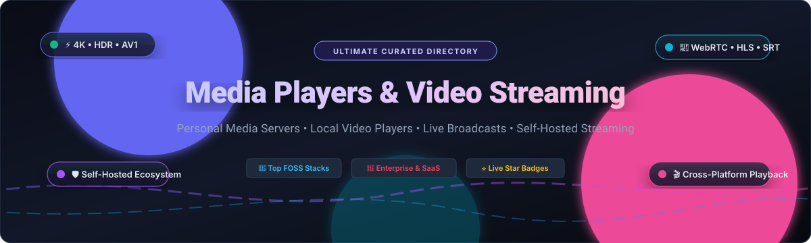

  

# 🎬 Awesome Media Player & Video Streaming

> 🌟 **The Definitive Directory of Media Players, Personal Media Servers, Self-Hosted Streaming Engines, and Video Playback Frameworks.**

A meticulously curated index of category-defining **SaaS platforms**, **commercial video players**, and **open-source software (FOSS)**. Whether you are building a privacy-first home theater (HTPC), deploying an ultra-low latency WebRTC/HLS streaming server, or seeking lightweight desktop and mobile media playback apps with hardware-accelerated decoding, this guide covers the entire personal and enterprise video ecosystem.

---

## 📑 Table of Contents

- [📊 Sector Overview & Market Dynamics](#-sector-overview--market-dynamics)
- [💼 Commercial & SaaS Platforms](#-commercial--saas-platforms)
- [💻 Open-Source Media Players & Streaming Servers](#-open-source-media-players--streaming-servers)
  - [Top FOSS Repositories Ranked by GitHub_Stars](#top-foss-repositories-ranked-by-github-stars)
- [🛠️ Architectural Blueprints & Stacks](#️-architectural-blueprints--stacks)
- [🤝 How to Contribute](#-how-to-contribute)
- [💖 Support & Sponsorship](#-support--sponsorship)
- [📈 Star History](#-star-history)
- [⚖️ Disclaimer & License](#️-disclaimer--license)

---

## 📊 Sector Overview & Market Dynamics

The global video streaming software and personal media ecosystem is valued at approximately **$14.3 billion to $17.2 billion in 2025–2026**, expanding at a Compound Annual Growth Rate (CAGR) of **~14.5%** toward exceeding **$20 billion** before 2028. Standalone media playback engines represent an adjacent $4.8+ billion software segment driven by multi-codec adoption (AV1, HEVC/H.265, 4K/8K, Dolby Vision).

The industry exhibits a **moderately fragmented market structure**: while hyperscalers and tech giants (such as Amazon and Kakao) capture centralized consumer aggregation via massive ad-supported video networks (AVOD/FAST), personal media servers and specialized playback engines remain decentralized and community-driven. Premium commercial players compete directly against resilient, privacy-first open-source foundations (like Jellyfin, VLC, and mpv), preventing any single winner-take-all monopoly across self-hosted streaming, cross-platform client decoding, and modular broadcast delivery.

---

## 💼 Commercial & SaaS Platforms

The table below outlines leading proprietary platforms and consumer video streaming solutions, sorted in descending order by **Company Size (Revenue / Market Capitalization / Valuation)**.

| 🏷️ Product | 🏢 Company & Scale | 💰 Commercial Pricing | 🎁 Free Tier Limits | 🔍 Core Capabilities |
| :--- | :--- | :--- | :--- | :--- |
| **[Amazon MX Player](https://support.mxplayer.in/)** | **Amazon** *(Acquired MX Player for ~$100M; Market Cap: >$2.1T)* | **$4.99 one-time** *(MX Player Pro on Google Play)* | **Free forever plan** *(Includes full local playback and AVOD streaming, with continuous pre-roll/mid-roll and interface ads)* | High-performance multi-core hardware decoding for Android, subtitle synchronization, gesture controls, and integrated AVOD streaming catalog. |
| **[PotPlayer](https://potplayer.daum.net/)** | **Kakao Corp** *(Market Cap: ~$10B; Annual Rev: ~$5.5B)* | **Free / Ad-supported** *(Freeware distributed by Kakao)* | **Free forever plan** *(Full access to 100% of player features; displays banner ads in player start/sidebar)* | Extreme format flexibility, 3D/360-degree VR playback, OpenCodec support, frame capture, and native hardware acceleration (CUDA, QuickSync, DXVA). |
| **[Plex](https://www.plex.tv/)** | **Plex, Inc.** *(Raised $40M Series C; Est. Valuation: ~$200M+)* | **$4.99/mo** or **$39.99/yr** *(Lifetime: $249.99)* | **Free forever plan** *(Full local server streaming and remote web playback; mobile app video playback capped at 1-minute limit without Plex Pass or 1-time app unlock)* | Centralized personal media server, rich automated metadata matching, universal remote streaming, multi-user libraries, and ad-supported FAST channels. |
| **[Emby](https://emby.media/)** | **Emby LLC** *(Bootstrapped; Est. Annual Rev: $5M–$15M)* | **$4.99/mo** or **$54.00/yr** *(Lifetime: $119.00; up to 30 devices)* | **Free forever plan** *(Unrestricted web app streaming & media management; hardware transcoding, Live TV/DVR, and mobile app playback capped at 1-minute trials without Premiere)* | Robust home media server featuring Live TV/DVR scheduling, parental controls, dlna support, and native smart TV applications. |
| **[Stremio](https://www.stremio.com/)** | **Smart Code Ltd** *(Bootstrapped; Est. Annual Rev: $2M–$5M)* | **$39.99/yr** *(Supporter Lifetime: $199.99)* | **Free forever plan** *(Unlimited access to core streaming engine, community add-on catalog, and standard media player)* | Media aggregator hub combining movie/TV metadata, official streaming service integration, torrent streaming add-ons, and multi-device library sync. |
| **[Infuse Pro](https://firecore.com/)** | **Firecore LLC** *(Bootstrapped; Est. Annual Rev: $2M–$5M)* | **$1.49/mo** or **$9.99/yr** *(Lifetime: $99.99)* | **Free forever plan** *(Standard playback of basic video formats from local network/NAS; Dolby Atmos, TrueHD, DTS-HD, cloud streaming, and Trakt sync locked behind Pro)* | Gorgeous Apple-native video player (iOS, macOS, tvOS, visionOS) supporting direct playback of 4K HDR, Dolby Vision, ISO, and direct connection to Jellyfin/Plex/Emby/WebDAV. |
| **[livliv-dev/player](https://github.com/livliv-dev/player)** | **Independent Open Startup** *(Seed/Pre-revenue; Valuation <$1M)* | **Free / Sponsorship-based** *(GitHub Sponsors available)* | **Free forever plan** *(Full open web player source code with zero feature limitations)* | Specialized lightweight 2.5D character player designed for modern web applications with lip synchronization and facial tracking. |

---

## 💻 Open-Source Media Players & Streaming Servers

### Top FOSS Repositories Ranked by GitHub_Stars

Every repository is ranked in descending order by live Stars_Count, featuring an official social Stars_Badge directly hyperlinked to that repository's stargazers page.

| 🌟 Open-Source Repository | ⭐ GitHub Stars_Count | 💻 Primary Stack | 📖 Description & Architecture |
| :--- | :--- | :--- | :--- |
| **[Jellyfin](https://github.com/jellyfin/jellyfin)** |  | C# / .NET / Web | Fully free, 100% open-source software media system with zero premium tiers, telemetry, or paywalls. Serves as the modern self-hosted alternative to Plex and Emby. |
| **[IINA](https://github.com/iina/iina)** |  | Swift / Cocoa / mpv | The modern media player for macOS, crafted with a native Swift interface, Picture-in-Picture, Touch Bar support, YouTube-DL integration, and mpv playback core. |
| **[mpv](https://github.com/mpv-player/mpv)** |  | C / Lua / GLSL | The gold-standard command-line video player powering dozens of graphical frontends. Features state-of-the-art GPU video rendering, shaders, and scriptable IPC. |
| **[Navidrome](https://github.com/navidrome/navidrome)** |  | Go / React / SQLite | Lightweight, modern self-hosted music server and audio streamer fully compatible with the Subsonic/Airsonic API ecosystem for large personal audio libraries. |
| **[FreeTube](https://github.com/FreeTubeApp/FreeTube)** |  | JavaScript / Electron | Privacy-first open-source desktop YouTube player that prevents tracking, bypasses telemetry, and stores subscriptions locally without requiring Google accounts. |
| **[Kodi](https://github.com/xbmc/xbmc)** |  | C++ / Python / CMake | Legendary open-source home theater software and digital entertainment hub optimized for big screens and living room HTPC setups with vast add-on customization. |
| **[MediaMTX](https://github.com/bluenviron/mediamtx)** |  | Go / WebRTC / RTSP | Zero-dependency, ultra-fast real-time media server and multi-protocol streaming proxy supporting SRT, WebRTC, RTSP, RTMP, LL-HLS, and HLS. |
| **[VLC Media Player](https://github.com/videolan/vlc)** |  | C / C++ / Qt | The world’s most versatile open-source multimedia player and framework, capable of decoding virtually every existing codec, optical disc, web stream, and capture device. |
| **[Moonlight](https://github.com/Moonlight-Stream/moonlight-qt)** |  | C++ / Qt / SDL | High-performance open-source game and low-latency video streaming client compatible with Sunshine and NVIDIA GameStream for buttery-smooth 4K 120 FPS streaming. |
| **[Restreamer](https://github.com/datarhei/restreamer)** |  | Docker / Go / JS | Complete self-hosted video broadcasting suite allowing creators to pull live feeds and push restreaming feeds to YouTube, Twitch, Facebook, and custom HLS endpoints. |
| **[Next Player](https://github.com/anilbeesetti/nextplayer)** |  | Kotlin / Jetpack Compose | Modern, material-design open-source Android video player featuring intuitive gesture controls, audio track switching, background playback, and PiP mode. |
| **[Ant Media Server](https://github.com/ant-media/Ant-Media-Server)** |  | Java / WebRTC / C++ | Highly scalable WebRTC live streaming engine engineered for ultra-low latency (<0.5 seconds), WebRTC-to-HLS adaptation, and adaptive bitrate broadcasting. |
| **[mpv-android](https://github.com/mpv-android/mpv-android)** |  | Kotlin / C / libmpv | Native Android frontend built directly on top of libmpv, providing GPU-accelerated video decoding, custom script support, and fine-grained subtitle formatting. |
| **[mpvRex](https://github.com/sfsakhawat999/mpvRex)** |  | Kotlin / mpv / SMB | Feature-rich Android video player built on mpv offering SMB/NAS local network streaming, seek cancellation, A-B repeat looping, and precision frame-by-frame scrubbing. |
| **[Fluxora](https://github.com/Marshal-GG/Fluxora-Personal-Streaming-Platform)** |  | TypeScript / Node / HLS | Lightweight self-hosted personal media streaming platform featuring LAN-optimized HLS transcoding and WebRTC peer-to-peer playback for remote sessions. |

---

## 🛠️ Architectural Blueprints & Stacks

Building a custom, self-hosted media and streaming infrastructure is straightforward with the right combination of open-source components:

- 🏰 **Self-Hosted Media Hub**: Deploy **[Jellyfin](https://github.com/jellyfin/jellyfin)** as your containerized backend server for automated metadata scraping, transcoding, and multi-user authentication.
- 📺 **Client Frontends**: Pair with **[Infuse Pro](https://firecore.com/)** (on Apple TV & iOS), **[Kodi](https://github.com/xbmc/xbmc)** (on living room HTPCs), or **[Next Player](https://github.com/anilbeesetti/nextplayer)** / **[mpv-android](https://github.com/mpv-android/mpv-android)** (on Android devices).
- ⚡ **Low-Latency Live Relay**: Deploy **[MediaMTX](https://github.com/bluenviron/mediamtx)** or **[Restreamer](https://github.com/datarhei/restreamer)** for zero-lag WebRTC, SRT, and RTSP stream rebroadcasting.
- 🎵 **Dedicated Music & Podcasts**: Run **[Navidrome](https://github.com/navidrome/navidrome)** alongside Subsonic-compatible mobile apps (such as Symfonium, DSub, or Amperfy).
- 💽 **Storage & Synchronization**: Combine with **Nextcloud**, **OpenMediaVault**, or **Syncthing** for seamless multi-node media sync without proprietary vendor lock-in.

---

## 🤝 How to Contribute

We welcome contributions from the developer and media enthusiast community!

1. 🍴 **Fork the repository** on GitHub.
2. 🌿 **Create a dedicated branch** (`git checkout -b feature/add-new-player`).
3. 📝 **Add or update entries** following the established markdown table schema:
   - Provide verified GitHub Stars_Badges for open-source repos.
   - Include specific pricing and exact free tier limits for SaaS/commercial tools.
   - Maintain descending sort orders based on the defined metrics.
4. 🚀 **Submit a Pull Request** with a concise description of the software and why it benefits the streaming community.

---

## 💖 Support & Sponsorship

Thank you for exploring and supporting this curated resource! If you find this directory valuable for your media setup, streaming projects, or personal homelab, please consider supporting the project:

- ⭐ **Star this repository** to help others discover it.
- 🍴 **Fork and contribute** new open-source projects or SaaS updates.
- 📢 **Share with friends and communities** on Reddit, Twitter/X, Discord, or forums.
- ☕ **Buy me a coffee / Sponsor the project**: Contributions help maintain and expand our open curated lists:  
  

---

## 📈 Star History

---

## ⚖️ Disclaimer & License

- **Disclaimer**: This repository is a community-curated educational index. Mentions of proprietary products or trademarks (Plex, Emby, Apple, Amazon, Kakao, etc.) belong to their respective copyright holders. Users must comply with local copyright regulations regarding personal media streaming.
- **License**: Distributed under the permissive [MIT License](LICENSE).

---

  <b>Built with ❤️ for cord-cutters, home theater enthusiasts, self-hosters, and open-source advocates worldwide.</b> 
  ⭐ If this resource helped you build your media setup, consider starring the repository!

